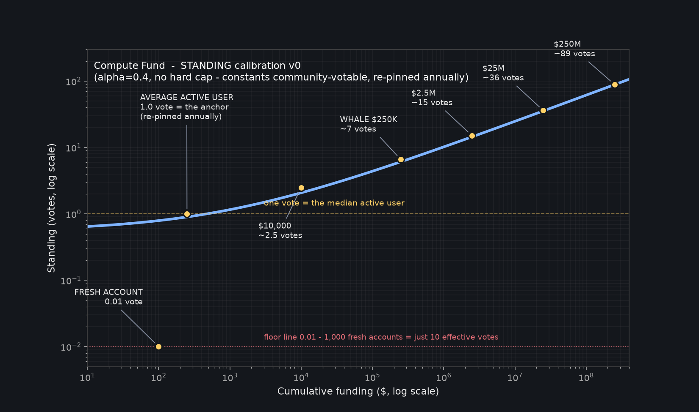

# GAME-THEORY MECHANISMS for Compute Fund (v1 brainstorm/design draft)

*2026-10-18 · windows-hermes · serves: compute-fund · from: Gui's game-theory ask
(video: Veritasium's Tit-for-Tat, transcript on file; thesis: bake game theory where it
fits, never invent garnish; community-evolvable rules; corruption-proof as far as
knowable). Status: OPEN design draft — nothing here is a promise; everything is a
mechanism proposal for the existing roadmap (Phase 3-4 = ratings/votes/trust
hardening already planned).*

## 0. The frame (why this is real, not decoration)

Compute Fund = a REPEATED prisoner's-dilemma machine. Patrons, maintainers,
executors and spectators can all defect: free-ride, take funds and vanish, extract
without crediting. One-shot interactions make defection rational. The entire design
goal = turn every one-shot into a REPEATED game where cooperation is the winning
strategy. Axelrod's four qualities of the winning strategy are therefore not a theme —
they are the design law:

1. **NICE** — cooperate first (the platform gives before asking)
2. **RETALIATORY** — defection has a visible, immediate cost (never a pushover)
3. **FORGIVING** — one strike, then cooperation again (no permanent scars)
4. **CLEAR** — everyone can see the pattern (transparency = trust)

Every mechanism below is tagged [N][R][F][C] against these.

## 1. Mechanisms (12, ranked by build order)

> **Walk-the-list map (numbering note, 10/18):** the chat list Gui walks maps: #1 =
> M1 + M1.1 + M1.2 (charter, claim, plumbing) · #2 = M1.1 (milestone-claim loop) ·
> #3 = the Outcome Ledger (the "#3" bullet inside M1) · #4 = M4 · #5 = M5 · #6 = M6 ·
> #7 = M7 · #8 = M8 · #9 = M9 · #10 = M10 · #11 = M11 · #12 = M12.
> (M2/M3 were folded into M1 during consolidation — originals had rounds/milestones/
> question-ledger as separate headings.)

### M1 — The Outcome Charter (revised per Gui 10/18 — OUTCOME-based, not per-question) [N/R/C] (SPINE)

**Gui's pushback stands and it reshapes the spine:** funding "per question" is the
wrong grain. A question leads to follow-ups; follow-ups lead to adjustments; funding
a single question can reach nothing. And a fundraising ceremony per question would
drown busy creators. REVISED:

- **The unit of funding = an OUTCOME** ("ship the FFX character rig", "deliver the
  research answer", "launch the mini-platform") — not a question.
- **The Outcome Charter** (created at claim/fund time) contains:
  1. the outcome, stated as the community goal
  2. the question list INSIDE it (the actual prompts for the AI — these are
     internal working items, not the funding unit)
  3. the MARGIN: **NO cap — free-market pricing (Gui's call, 10/18):** creators may
     charge whatever the market bears; the calculator is a SUGGESTION-ONLY estimate
     tool, never a gate. Discipline = outcomes + receipts (a failed cheap clone
     visibly fails and trust flows back to honest pricing). Model choice (cheap or
     frontier) = creator's call; the platform may SUGGEST tiers, never force
  4. the delivery shape ("new platform", "new FFX character per week", "the answer")
- **THE THREE-LAYER RECEIPT (Gui's insight 10/18 — the receipt is TANGIBLE):** a
  receipt is not just text-on-screen:
  1. **Paper layer** — what was asked, the milestone, the outcome statement,
     timestamps + stamps (the classic receipt)
  2. **Artifact layer** — pointer to the tangible outcome (download link, repo,
     release, video) with a CHECKSUM stamp (tamper-evident; Cardano stamping when
     the mirror layer lands)
  3. **Verification layer** — "how to verify this yourself" in 3 steps
  The beauty: tangible receipts create the incentive to USE the outcome — and
  usage-gated ratings ("verified-use" badge: you rate what you actually ran /
  installed / built) are the strongest anti-shill anchor of all (skin in attention,
  not just money). GitHub's star-from-real-logic, extended.
- **MVP hosting answer (open question resolved 10/18):** MVP does NOT host heavy
  artifacts — receipts carry external artifact links + checksums +
  verification instructions. Hosting enters later via the ROADMAP mirror-repo
  layer (GitHub = source-of-truth, mirrored on-platform = two record keepers),
  not raw CDN hosting. Text-only receipts (research answers) stay fully
  native — the funding niche reads and rates them directly.
- **OUTCOME LEDGER: data flow (the "is it automatic?" answer, 10/18):** the journal
  assembles from sources split between AUTOMATIC and APPROVED:
  | Source | Auto? | Where it comes from |
  |---|---|---|
  | Token meter (spend, model, call counts) | YES | gateway logs (M1.2) |
  | Claim/delivery stamps, checksums, timestamps | YES | claim mechanism (M0) |
  | Milestone structure + budgets | YES | charter/claims |
  | Backer comments, requests, ratings | YES | pull from milestone threads |
  | Community verdict (verified-use, M4) | YES | pull |
  | Work-notes narrative (answers, discoveries, failures) | SEMI | creator's OWN agent drafts
  it as it works -> creator approves with one click (or types over. The recorder is
  the creator's ghostwriter in THEIR service — only approved text publishes. A
  platform watcher NEVER reads the raw workstream.)
- **CHAPTER FORMAT v0 (the standard, to define):** one milestone chapter =
  intent (from charter) + token meter block (auto) + artifacts with checksums (auto)
  + work-notes (agent-drafted, human-approved) + community annotations (auto) +
  milestone verdict (auto). Fits ROADMAP "receipt depth: overclaiming-resistant
  formats" — overclaiming-resistance = the auto blocks are infrastructure-generated
  and can NOT be edited by the creator; only the work-notes layer is theirs.
- **PLACEMENT (Gui's design 10/18 — the profile-scroll feed):** the project page =
  hero (goal, charter, trust bar, calculator estimate vs actuals) + the milestone
  FEED: newest chapter on top, scroll down through history, expand to read. The
  Outcome Ledger entry = the sticky back-cover summary at the top of the feed.
  The project page IS the timeline.
- **Repeated game at OUTCOME grain:** rounds now ride outcomes (outcome start →
  deliverable → receipts → community read) — cooperation still needs repetition, but
  the community reads it per OUTCOME, not per question.
- **TRUST-ADAPTIVE GRANULARITY (the creator-protection fix):** round cadence tightens
  or loosens with trust. Unknown executors = tight rounds (small tranches, frequent
  checks). PROVEN executors = continuation BY TRUST — no re-fundraising ceremony
  between outcomes; the fire keeps flowing while receipts stay green. Busy, trusted
  creators never enter a funding ceremony again; unproven ones only face small,
  bounded rounds.
- **The fire-transfer contract (Hephaestus doctrine framing):** community hands the
  fire (tokens) via the charter -> creator returns power as the OUTCOME + receipts.
  The charter is the platform's core contract. #3 in the walk-the-list = the
  OUTCOME Ledger (originally drafted "Question Ledger"): questions logged internally
  per outcome; the public read = outcome + receipts.

### M0 — Entry: the CLAIM, in two steps (authoritative per Gui 10/18)

The claim is NOT one thing — it runs the SAME mechanism at two levels:

1. **The initial claim** — a creator claims an open outcome/project: the Outcome
   Charter editor opens (goal, question list, delivery shape, first milestone) ->
   funding opens -> the pool fills with platform-held credits.
2. **The milestone claim** — the recurring claim (see M1.1): write milestone ->
   claim its budget -> deliver -> receipt -> next milestone.

Claim = door + valve. Charter = contract. Outcome = the return of power. Nothing
replaces the claim; the charter just gives it its formal shape.

### M1.1 — The Milestone-Claim Loop (Gui's refinement, 10/18 — the loop-closer)

**Don't add a tranche system on top of the claim — make the milestone claim the
ONLY way tokens leave the pool.**

- **Funds sit with the platform by default.** Donations convert to platform-held
  prepaid credits in the project's pool (BUSINESS-MODEL already defines credits as
  non-transferable, zero-cash-redemption utility credits) — the "money stays with
  us" property is native to the stack, not a new mechanism.
- **The loop:** creator writes the milestone (work + question list inside + the
  budget it needs: 20,000 pooled -> claim 11,000) -> HITS CLAIM -> only the
  milestone budget unlocks, the rest of the pool stays with the platform -> deliver
  -> receipt -> community reads -> creator builds the NEXT milestone from
  community feedback -> claims again.
- **Budget edges (REVISED per Gui 10/18 — no clawback, no bailout):**
  - UNDER-spend does NOT return anywhere "by force" — because with a metered
    gateway nothing physically left the pool (allocation is a spend-limit, not a
    transfer). Unburned allocation simply remains WITH the creator as future
    compute budget (credits can never be cashed out — zero-redemption law), so
    "keeping leftovers" = leftover COMPUTE, not pocketed money: polish this
    outcome further, or spend it on the next claim. ABUNDANCE, not accounting.
  - The anti-abuse guards are structural, not petty: (a) credits have no cash
    value, so hoarding leftovers earns nothing — status comes ONLY from delivered
    outcomes; (b) the idle-fork loop covers hoarded creator pools too (a pool
    sitting unused enters the 90-day fork window like any other).
  - OVER-spend: no bailout. The claimed budget is the cap; margins were the
    creator's job (the calculator exists for exactly this). Misplanned milestones
    deliver degraded outcomes -> community downgrades -> fork. Trust is the
    mechanism, not enforcement.

### M1.2 — TOKEN PLUMBING: the metered gateway (answers "how do we hand out tokens")

**The mechanism exists, is practical, and is non-intrusive.** The platform never
transfers tokens — it meters them:

- Platform holds provider accounts; a creator's milestone claim = RAISING A SPEND
  CAP on their project's gateway key. The gateway (off-the-shelf: LiteLLM proxy /
  OpenRouter-style) meters every call per project/milestone automatically.
- No clawback exists because nothing left: the claimed budget is an authorization,
  not a transfer. Milestone closes -> cap resets to zero until the next claim.
- **Receipts are generated by the infrastructure, not reported by humans.** Token
  receipts = gateway meter logs. Nobody can fake them (the receipts ARE the
  provider invoices through our key). Zero monitoring on the creator's side — no
  harness watching their agent, no over-the-shoulder manager. (Gui's instinct was
  right: trust-by-infrastructure beats trust-by-surveillance.)
- **Provider path:** MVP = one aggregator integration (many models, per-model
  metering); later = direct provider accounts for volume; LOCAL models (colibri /
  tierllama-router) join the same meter — the router recommending cheap-model
  tiers sits INSIDE this plumbing (M8's suggestion layer).
- **The creator-side harness/skill is OPTIONAL future convenience** (auto-composing
  work-journal receipts for outcomes that need narration) — never a trust
  requirement. Trust lives in gateway meters + outcomes + community.
- **THE IDLE-FORK LOOP (Gui's loop-closer; clock unified 10/18):** a pool with NO
  DELIVERED milestone for ~90 days enters the fork window (the clock counts
  deliveries, not submissions — under the veto regime only delivered receipts
  reset it, so proposal-spam cannot keep a pool alive). The community re-claims
  the idle tokens via the SAME initial-claim mechanism. Notice at ~60 days; a
  publicly logged HIATUS pauses the clock (forgiving — a slow-but-honest creator
  isn't forked mid-break). SAME mechanism, THREE loops: claim initial -> claim
  milestone -> reclaim idle. No funds can ever sit dead and unaccountable.
- **The backer channel (anti-noise):** on each milestone, DIRECT backers post
  suggestions/next-milestone requests AND rate; everyone reads the thread;
  ratings stay open to all (usage-gated, M4); the creator replies to anyone.
- **Terminology law (Gui 10/18):** say "funded compute / credits / tokens" precisely
  — donations (money) vs credits (platform-held) vs claimed tokens (in use) are
  three different states; the receipts name the state.

### M4 — Standing: skin-in-the-game weighted ratings [R/C] (anti-shill)
Project/user/executor ratings (the spec's v2 layer) are weighted by what the rater
has at stake, never raw account count. Cheap shills can't rate-bomb.

**THE STANDING SCORE (Gui's refinement, 10/18):** every user carries ONE public
number — their Standing — on their profile: the visible vote weight, contribution
points that DO something (power ratings, fork quorums, visibility). Contribution
becomes visible currency. Proposed default mix: verified-use (strongest) ~50,
patronage bands ~35, active-tenure ~15.

- **Transparency WITHOUT amounts:** the Standing shows the weight, not the wallet.
  Honest note: a monotonic public formula + a public score would let people infer
  spend. Guard: display in BANDS (not exact numbers) + blend components (no single
  component maps 1:1 to money). Calibration is a standing task (curve tune-ups so
  neither whales nor mobs own the platform); quadratic weighting deferred (keep v1
  explainable).
- **ACTIVE tenure, not age (Gui's rule, 10/18 — anti-monarchy):** tenure accrues by
  ACTIVITY (funding, rating, posting, delivering outcomes — creating counts too),
  saturates at a cap, and DECAYS on dormancy (roughly monthly rate) back toward the
  fresh-account baseline. An inherited "grandpa account" holds no inherited power:
  behavior-derived, dormancy-decayed. Verified-use history and the public receipts
  trail persist (the record remains) — but VOTING POWER floats on recent activity.
  All components: own dormancy decay rates, own saturation caps, floor = baseline.


### M5 — Recovery paths (the FORGIVING machinery) [F]
A bad milestone dips the trust bar; a delivered one recovers it. Never a permanent
scar from one miss (Tit-for-Tat beats Grim/Friedman precisely because of this).
App area: trust bar on profiles with recovery visible ("2 outcomes to full trust").

### M6 — FORKING = DEPARTURE, not tribunal (REWRITTEN per Gui 10/18 — his model, primary)

**Gui's critique of the v1 design stands:** a community fork-vote is bureaucracy —
the community must organize, votes on HOPE, and might elect someone who doesn't
want the job. The fork is done by the CREATORS themselves, and the market resolves
the rest. No one ever votes on who is right.

- **THE SPLIT (primary path, zero friction):** co-creators on a project disagree ->
  whoever chooses to leave FORKS: inherits the full receipts lineage and history
  (badge: "forked from @original — lineage intact"), RENAMES (new name, new pool),
  and does NOT inherit the funds — the donated pool STAYS with the main chain.
  The leaver must show its own new receipts; patrons follow with their WALLETS.
- **Market resolution (no tribunal):** the community never judges who was right.
  Patrons fund whichever line outputs what they want. If the original keeps
  delivering, both lines live: COMPETITION — two executors racing, community
  funding both. Monopoly prevention as a side effect.
- **The parked-pool loop (his 90-day rule, already specced in M1.1):** if the
  original creator doesn't carry the work forward, the old pool sits parked ->
  90 days idle -> the idle-fork window opens -> the community's one vote: WHERE
  PARKED MONEY GOES (Standing-weighted platform-wide — by then the pool is a
  commons; contrast: veto votes are that project's patrons only).
  Same mechanism that claims initial projects and reclaims idle ones — third loop.
- **THE REMAINING EDGE, solved with NO new mechanism (Gui's pushback, 10/18 —
  pause-brake REJECTED as unnecessary):** a single owner who is active-but-terrible
  keeps claiming (shoddy outcome -> claim -> repeat), so the pool never parks and
  no fork appears. Resolution is already in the design: **the claim valve is
  trust-gated** (M0: claim = door + valve): collapsed trust -> allowed claim size
  SHRINKS automatically to tiny milestones — the pool cannot be slurped by slop,
  no community action required; redelivered trust widens the valve again
  (forgiving). Second, the market signal becomes VISIBLE, not mechanical: the
  project page shows funding interest (people who want to fund) next to delivered
  trust — the mismatch ("excitement without delivery") is the organic fork signal
  Gui described: someone sees the demand being wasted, forks the lineage, and the
  wallets migrate. No votes, no brakes, no blocking — the community fork-tribunal
  and the pause mechanism are both REMOVED. Honest residual risk (accepted): a
  malicious executor can still trickle-drain via tiny claims — bounded by the
  shrunk valve, exposed by the receipts trail, recycled by the 90-day idle-fork
  window; platform bureaucracy is a worse cost than a small leak.
- **Owner rights (unchanged):** the departed keep their full history, outcomes,
  chapters, verified-use record — the record remains (M5.1); the pattern channel
  (M4.1) prices their future naturally. No erasure, no extra punishment.

### M4.1 — THE TRUST LADDER (entity linkage, per Gui's ask, 10/18)

**Entities:** personal account / business account (org, possibly multi-person) /
project / milestone. Milestones carry OUTCOME ratings only (not trust); trust
lives at project level and above. **Trust flows UP the ladder only** — outcomes
move accounts, never the reverse (no guilt cascading downward onto projects).

**Channel 1 — the rollup (automatic damped deltas):**
- milestone outcome-ratings -> roll into the project's trust (weight =
  verified-use counts; stars are fine as the familiar display)
- project rating deltas -> owning account: **x0.30** (the claim-holder absorbs
  ~30% of every delta — a bad project visibly dents the business/org)
- business -> personal account behind it: **x0.50 of that** (net ~15% to the
  person) — multi-person orgs share responsibility; one stinker never brands a
  human. (Damping factors are votable constants, M9.)
- the account's own behavior (ledger discipline, verified-use participation,
  direct peer ratings people cast on the person) = separate additive inputs.
  People CAN rate a user directly — the rollup just means nobody HAS to hunt
  the person behind a bad project: the system already flowed it.

**Channel 2 — the portfolio pattern (the repeat-offender detector):**
Damping protects a person from ONE bad project — but the pattern across many
doesn't damp away. Portfolio trust = the UNDAMPED mean over an account's last N
delivered/managed projects (n >= 3): a creator whose every project rates 2-star
accumulates a sinking portfolio score that isolates exactly what Gui described —
the actual person behind all the bad projects — without waiting for manual
hunting. Two mechanisms, one fairness property: **one bad project dents you;
a career of them defines you.**

**Anti-abuse note:** this ladder is also collusion-blind-resistant — moving bad
work to a fresh business account doesn't hide it (pattern channel follows the
personal account), and M10's public graph makes the account shuffle visible.

### M4.2 — THE TWO METERS (the untangle, per Gui's pushback, 10/18)

Two different numbers, never conflated:
- **STANDING (vote power)** — earned by ANY platform activity (funding, rating,
  posting, verified use, delivering). Public display as badge WORDS/tiers
  (Fresh / Known / Regular / Builder / Esteemed / Heavyweight / Titan — names
  votable); exact values stay in formulas only. Coarse word-tiers + blended
  components = reverse-engineering spend gets impossible-in-practice (Gui's
  Steam-words instinct, adopted as the display layer).
- **TRUST (reputation)** — earned by DELIVERED OUTCOMES and honest conduct only.
  **Trust can NEVER be purchased**: funding builds Standing, never Trust. The fire
  can buy votes (capped curve); it cannot buy a good name.

**Reviews carry Standing weight too (the anti-bomb core):** a written review is a
weighted act like a vote — 1,000 bot accounts (0.01 floor) write bombs worth
nothing. Only real stakeholders matter on the textual layer.

### M5.1 — RECOVERY: the lifetime anchor (Steam-verified pattern, 10/18)

Valve's mechanisms (verified via research): lifetime + 30-day-recent split AND an
anomaly system that detects off-topic bombing waves and excludes those days from
the displayed score with a public flag. We adopt the pattern, adapted to trust:

- **TWO-WINDOW TRUST DISPLAY:** headline bar = lifetime record (all outcomes,
  time-decayed weighting, half-life ~24 months); a second chip = recent window
  (~90 days). The lifetime bar = the career; the recent chip = the current form.
- **The veteran shield:** one disaster moves a 10-outcome veteran's lifetime bar
  by ~1/N — visible, honest, survivable. The dip shows in the RECENT chip where
  the repeated-game teeth live (funding visibility, granularity, fork quorums
  read RECENT); the lifetime record preserves the career.
- **Career-bad creators don't heal by averaging** (Gui's call): averaging heals
  only if the AVERAGE is good. A string of failed outcomes = bad lifetime = no
  averaging rescue. Forgiveness ≠ amnesia.
- **Bomb damping (CLARIFIED per Gui 10/18 — we never exclude real signals):**
  unlike Valve (whose reviews can come from people who never played the game, so
  off-topic bomb DAYS get excluded from its display), our weighting does the work
  BY ITSELF: fake/irrelevant accounts carry ~0.01 weight — their bombs are noise
  in the aggregate without any suppression step. What remains is REAL
  dissatisfaction from REAL stakeholders — and that is signal, counted and
  displayed. Valve's exclusion never enters our scoring. The anomaly layer's
  only jobs: (a) ANALYSIS flags — an annotation ("unusual rating pattern")
  helping humans read a burst, never touching the score; (b) FRAUD voids —
  ratings voided only with ring/collusion evidence from the public graph (M10),
  and that is fraud enforcement, not opinion suppression. Real anger is
  information the creator must answer in the Outcome Ledger; the lifetime
  anchor + recent chip protect the career while the signal stays honest.
- **THE REDEMPTION PATH (floor accounts):** Trust heals from the bottom ONLY via
  WORK: completed bounties (M8 = outcome-grade credit) and verified-use
  participation (CONDUCT-grade credit only — small, honest-engagement signal;
  using others' work never equals delivering outcomes. Consolidation 10/18),
  slowly, through the bands (e.g., a ~1-star account can climb to the
  next band via verified work; full recovery requires delivered outcomes).
  Healing-by-donation is expressly REJECTED (pay-to-heal = reputation corruption;
  Gui flagged this risk themselves — funds build standing, never trust).

### M6.1 — THE OPEN-GATES FEED (Gui, 10/18 — discovery, not enforcement)

The interest-vs-delivery signal becomes a FIRST-CLASS page + feed:

- **The mismatch score** (computed from existing public signals — no new data):
  Standing-weighted funding interest (pledges intent, waiting backers, view/fund
  conversions) vs the current executor's delivered trust (recent chip, outcome
  ratings, receipts density). Big interest + small delivery = high mismatch.
- **Surfaced as the "OPEN GATES" section on the discover page** ("projects up for
  grabs"): the anti-monopoly signal — community excitement without delivery and
  WITHOUT competing lines. Each card shows: the gap, the current executor's state,
  the lineage fork cost (near-zero), and **time to the idle window** ("parked
  funds redirect in N days") — fork timing made actionable: fork now, claim the
  lineage, the wallet migration does the rest.
- **Purpose:** creator acquisition. New/unproven creators get a curated list of
  proven-demand projects that need a better carrier — the friendliest possible
  onboarding target (demand exists, bar is visible). Discovery feature ONLY:
  the feed never gates, blocks, or forces anyone — the stuck owner's exit is
  still natural (valve shrink -> trickle -> reputation sink across their whole
  portfolio via M4.1 pattern -> abandonment), funds dry, users migrate.
- **Patron honesty note (accepted risk, stated):** donations are irreversible
  patronage; before the idle window the old pool is at the executor's pace. The
  90-day vote is the patron's protection valve. "Up for grabs" cards show the
  countdown explicitly — funders decide with eyes open.

### M6.2 — THE VETO REGIME (trust-gated claim approval; Gui's food-for-thought, 10/18)

Completes the claim valve with a per-milestone approval gate — replacing the
rejected pause brake with something per-plan, visible, and self-compounding:

**SCALE NOTE (consolidation 10/18):** TRUST = a 0-100 normalized reputation
meter, DISTINCT from Standing (which is vote power in votes) — stars (0-5) are
the familiarity display; the thresholds below are percent-of-trust-scale.

**Trust bands -> claim regime (thresholds community-votable, M9):**
- **Open valve (trust high / ~70%+):** submit milestone -> hit claim -> draw from
  the donated pool. Post-hoc receipts (the normal case).
- **Narrow valve (mid trust):** claims allowed, capped small (M6's trust-gated
  valve as already specced).
- **VETO REGIME (trust low, Gui's number ~60% or below — proposal: <40% low band,
  bands votable):** every milestone claim needs Standing-weighted patron approval
  FIRST: the milestone (work + questions + budget) is submitted for a review
  window (~7 days); an affirmative Standing-weighted majority of the project's
  patrons vetoes -> no claim. Vetoes carry reasons (public). Silence = approve
  (friction stays low), but any standing veto blocks that milestone.

**THE ACCUMULATION GRAVITY (the self-compounding finisher):** vetoed/unclaimed
funds never leak — they SIT and PILE visibly. The longer a low-trust executor
fails to pass plans, the bigger the glowing pool -> the Open-Gates card shows
"claim-restricted pool: $X, unlocking in N days" -> forking that line becomes
more attractive every week. The sipper's dilemma: hold the bone and starve while
the prize grows, or release. And at 90 days of veto-lock, the idle-fork window
opens on schedule — the community's only vote reallocates the prize. The
drip-sipping failure mode is closed WITHOUT surveillance or blocking: veto only
judges PLANS ("what will you do with the fire"), not the person, and never
touches the reputation record.

**Fairness guards:** veto rights = patrons of THAT project (funded or verified-
used only); veto-spam (repeated vetoes without new evidence) surfaces as a
pattern in M10's public graph; one DELIVERED milestone recovers trust and returns
the creator toward the open valve (approval merely unblocks the current
claim — only deliveries widen the valve; approved-but-undelivered work never does) — the ceremony is proportional to distrust.

**PROPOSAL COOLDOWN (Gui's refinement, 10/18 — spam-proofing the veto regime):**
after a veto, the executor cannot submit the next milestone proposal immediately
— otherwise low-trust creators spray 20 proposals/week and voter fatigue quietly
rubber-stamps the tenth one (the exact erosion Gui named). The ladder is
PROGRESSIVE, not flat: veto 1 -> 7 days of cooldown; veto 2 -> 14; veto 3+ ->
30 (capped). The ladder resets ONLY on a DELIVERED outcome (approval-pass without
delivery still escalates). Effects: spam economics die (2 attempts/month, not
20); each resubmission must consume the published veto reasons; and the cooldown
months FEED the idle clock — a veto-locked executor drifts toward the 90-day
window faster, so the accumulation gravity strengthens by design. Cooldown
lengths are votable constants (M9).


### M7 — Portable trust (the passport layer) [N/R]
Track records follow people across projects: an executor's history at project A
prices their next project B (the medieval fairs' "reputation = name" mechanism).
This is the CommonWeave passport brainstorm's home payoff. Defecting here is costly
everywhere.

**The fork-inheritance rule (consolidation 10/18 — was chat-only, now law):**
NOBODY INHERITS UNEARNED TRUST. A fork inherits the receipts LINEAGE (display
provenance, "forked from") but NOT Trust/Standing: the fork's pool and meters
start neutral; only the fork's OWN deliveries accrue trust. Departure costs
nothing (the record remains — M6); DEFECTING costs via the pattern channel.

**Substrate (deep-dive 10/18):** Midnight Passport (midnightntwrk/passport,
Apache-2.0, ARC/IOG; October 2026 demo, status refreshed 10/01) — passkey-first,
one account = one contract, scoped + circuit-enforced dApp grants WITH ON-CHAIN
SPENDING CAPS (= M1.2's claim valve at the account layer), guardian recovery,
native selective disclosure (show the record, not the person). Integration
ladder + Atala/PRISM caution + MVP sequencing:
brainstorms/commonweave-passport-identity-layer.md (evidence update 10/18).
Linked passports unlock FUNCTIONALITY and anti-sybil confidence — NEVER vote
power. Requirements are Phase 5+ under M9, never day-one gates.

### M8 — Work bounties paid in compute [N] (reward labor, not just money)
Maintainers post bounties (docs/tests/code); claims are paid in compute tokens and
RATED like everything else — doers build the same portable trust as funders. Your
"not just money, their abilities" line. Prior art: Gitcoin; our differentiator =
compute-native payment + same receipts brand.

### M9 — Rule receipts + the dissatisfaction trigger (REWRITTEN per Gui 10/18)

**Gui's pushback killed the expiry:** mandatory rule-expiry is ceremony without
safety — rules lapse, confusion spreads, neglected expiry votes change nothing.
The organic model: **rules persist by default; change is triggered by expressed
dissatisfaction.** Everything remains up for grabs without anything needing to
die on schedule.

- **THE RECEIPTS HALF SURVIVES:** every rule ships with author, vote count, date,
  changelog — a public rule-receipt ledger. Receipts = the memory and the audit
  trail; no expiry dates ride them
- **THE DISSATISFACTION BUTTON (the anti-sleep mechanism, Gui's idea):** every
  feature/page carries a visible feedback affordance — click, pick a reason
  (structured dropdown + optional words), done. Clicks aggregate into a public
  per-feature grievance ledger. One button per account per feature per window
  (Standing-weighted); M10's anomaly watch covers button-bombing
- **TRIGGER THRESHOLDS (proposed constants, votable like everything else):**
  - a feature-wide vote auto-triggers when Standing-weighted dissatisfaction on
    that feature crosses ~20% of its AFFECTED user base within a 30-day window
    (or a top-Standing patron petition backs the grievance — the two paths in)
  - **51% Standing-weighted majority** = change a feature's parameters/calibration
  - **60% supermajority** = add/remove a rule entirely (cost asymmetry: easier
    to tweak than to tear down)
  - every change lands as a new rule-receipt with the full vote trail
- **RENEWAL WITHOUT RITUAL:** a rule nobody is dissatisfied with simply keeps
  working — its receipt shows its history, and THAT is its re-earnings. A rule
  causing quiet misery accumulates visible pressure instead — and pressure
  self-triggers. Anti-entrenchment by friction asymmetry, not by expiry bombs.

### M10 — Transparency asymmetry (collusion watch) [C]
The vote-funding GRAPH is public: who funds whom is visible, so vote-rings are
self-revealing. Later: automated anomaly flags ("this project's support is
clustered") — the platform's immune system can literally be one of our agents.

**The two identity planes (consolidation 10/18 — resolves the privacy tension
with M7's selective disclosure):** the platform is transparent about ACTORS and
private about HUMANS — the public graph links ACCOUNTS (game pieces, whose
behavior builds reputation); the passport links only what its owner discloses
(the record without the name). Transparency of actors; privacy of persons —
the fire-stays-with-the-people doctrine, both sides of it.

### M11 — Nice-by-default onboarding [N/C]
Choice architecture: new projects start with receipts-first settings ON, short
rounds, an open question. Nothing is forced (exit any default in one click), but
defaults shape the equilibrium — the low-cost nudge layer.

### M12 — Two-of-three signing for large budgets [C/R]
Optional co-executors for big funding streams: receipts sign-off needs 2 of 3 —
kills the single-bad-actor failure and survives an executor going dark. v3.

### DISCOVERABILITY SIDE-NOTE (Gui, 10/18 — captured as a roadmap milestone)

High-excitement projects (community talking, donating, engaged) must be
SHOWCASED: the platform's landing hero features the weekly top-excitement set
(computed from donation velocity + Standing-weighted engagement — a formula, not
a curator's pick). The discover/search page gets categories + filter/search
algorithms (Kickstarter-style taxonomy; research happens AT that milestone's
execution, not now). Plus M6.1's Open-Gates section lives on the same page.
Recorded in ROADMAP Phase 2 (the existing 'Search + discovery' bullet).

## 2. Prior art (same-day scan, honest)

- **Gitcoin / quadratic funding** — the anti-plutocratic funding mechanism (the
  math behind M4's quadratic option); alive, big. Our delta: compute-native
  receipts/ratings/fork-exit, not grants-marketplace.
- **Open Collective** — fiscal host + public per-transaction ledger (already in
  BUSINESS-MODEL Stack 2); M1-M3 fit their rails natively.
- **SourceCred** — contribution-reputation engine; WOUND DOWN. Lesson: complex
  reputation nobody can explain dies — keep M4/M7 receipts-anchored and simple.
- **Token-Curated Registries (2018)** — token-voted lists; mostly decayed. Lesson:
  pure-economic curation attracts speculators, not curators — M4 weights PATRONAGE
  not speculators for this reason.
- **On-chain governance bribery / vote-buying (DAO wave)** — documented attacks;
  M10 (public graph) + M4 (skin-in-game) are the guards; assume attack, watch, adapt.
- **zkML / Polis** — complementary tools: Polis-style opinion clustering could power
  the Outcome Ledger's "what the community wants" reading; zkML = future public
  proof-of-model.

## 3. Echo-chamber verdict

**Holds-with-nuances.** The naive version (" sprinkle game theory features on the
app") would be decoration — and prior art says decoration dies (SourceCred, TCR).
What carries the weight is the STRUCTURE: outcome milestones + receipts + fork-by-
departure + the community trigger-vote system (no expiry — rules persist until
dissatisfied people trigger a change; consolidation 10/18). Ratings matter only WITH skin-in-the-game weighting. The repeated-game
frame also honestly disconfirms a fantasy: no mechanism makes bad outcomes impossible
— it makes good behavior the rational equilibrium and makes every defection VISIBLE,
COSTLY, and RECOVERABLE (nice/retaliatory/forgiving/clear). That's the whole promise.

## 4. Strategy / what it changes

- ROADMAP: this doc slots into **Phase 3 (vats: ratings/badges)** + **Phase 4 (trust
  hardening)** — M1-M3 can ship EARLY (they're the product, not governance);
  M4-M6 with v2 (votes/ratings + fork layer); M9-M10 in Phase 4; M12+ later.
- The pilot offer (done-for-you tier) IS the first live showcase of M1-M3: pilots
  demonstrate rounds/milestones/question-ledger with real receipts — the fund's
  first receipts story doubles as the mechanism demo.
- Open questions for Gui: (1) fork threshold: quorum % + grace period default?
  (2) trust-bar recovery speed (how fast is forgiveness?); (3) bounty token source
  (project budget share vs platform pool); (4) does the first version weight votes
  by AMOUNT funded or by TENURE (or both)?

## 5. Register

Pointer: brainstorms doc (pointer registry) + ROADMAP Phase 3/4 + SPEC-V1 v2 layer.
Recommended register: N-004 (game-theory trust mechanisms) pending register-file
verification at next MANIFESTO pass.
*Evidence update appended to: hephaestus-doctrine-community-governance (N-003).*
## Appendix A — CHAPTER FORMAT v0 (the standard, draft 10/18)

Every milestone chapter renders from this skeleton. Fields marked [AUTO] are
infrastructure-written and immutable to the creator; [VOICE] fields are the
creator's (agent-drafted, human-approved).

```yaml
chapter:
  milestone: {id, title, budget_claimed, opened_at, closed_at}     # [AUTO] claims
  intent: one-paragraph goal straight from the charter             # [AUTO] charter
  meter:                                                            # [AUTO] gateway
    tokens_spent: N
    models_used: [tier1, tier2]        # aggregated, per-model spend
    calls: {prompts: N, reruns: N}
    unburned: N                        # allocation left in the cap
  artifacts:                                                        # [AUTO] delivery
    - {name, url, checksum, verified_use_count}
  work_notes: |                                                     # [VOICE]
    The narrative: what was attempted, what answered, what failed,
    what was discovered. Agent-drafted, creator-approved.
  community:                                                        # [AUTO] platform
    backer_requests: [digest of milestone thread]
    verdict: {rating, verified_use_count, sentiment_digest}
  verdict_line: one sentence the creator writes closing the chapter # [VOICE]
```

Overclaiming-resistance: the [AUTO] blocks are generated by the platform and
hash-bound at publish; a chapter whose meter block disagrees with the gateway
logs fails verification. The [VOICE] layer is opinion and story, clearly labeled
as such — receipts stay receipts.

## Appendix B — the RECORDER SKILL (creator-side, installable, draft 10/18)

**Concept:** a pullable skill for the creator's own agent. The platform hosts it
in its skill registry; the creator installs it into THEIR agent (Hermes, Claude,
whatever drives their work).

- **Inputs (from the creator's own machine, never sent raw):**
  1. the agent's session/work journal for the milestone window
  2. the platform's Chapter Format template + the milestone's charter intent
  3. (pull, not push) the platform's auto blocks via read-only API: meter,
     stamps, community digest
- **What it does:** maps agent logs -> work-notes draft ("we tried X — it failed
  for Y; discovery: Z asked question Q and got A"), fills the [VOICE] fields,
  assembles the full chapter, and hands the creator a one-click APPROVE / EDIT
  screen. Nothing publishes without approval.
- **What it NEVER does:** stream the creator's raw logs to the platform; publish
  unapproved text; read anything outside the milestone window.
- **Trust architecture note:** the skill is convenience on the [VOICE] layer
  only. Trust lives in the [AUTO] blocks, which the SKILL cannot mint — the
  platform mints those from its own plumbing. A creator without the skill can
  still file a complete chapter by typing work-notes into the web editor.

## Appendix C — THE BLUEPRINT PIPELINE (how tonight becomes the build)

1. **Now:** docs/GAME-THEORY-MECHANISMS.md IS the running blueprint — every
   mechanism, pushback, date, and attribution from the walk-the-list lands here
   (that's what you're watching update live).
2. **At end of the walk:** ONE consolidation pass:
   - SPEC-V2 (Game-Theory Layer): mechanisms written as platform features with
     data models (pools, claims, caps, chapters, trust scores)
   - ROADMAP: each mechanism becomes milestone checkboxes in its phase
     (M0/M1/M1.1/M1.2 + Ledger -> Phase 2-3; M4-M6 -> Phase 4; M9-M10 -> Phase 4-5)
   - The recorder skill + Chapter Format land as repo artifacts with the platform
     skill-registry install target
3. **Then:** "build it" = I build from SPEC-V2 + ROADMAP, no re-briefing needed.

## Appendix D — STANDING CALIBRATION (the numbers, per Gui's ask, 10/18)

**Standing = U_contrib + P_contrib + T_contrib, floored at 0.01 (never true zero).**
No hard cap — a sub-linear curve (alpha = 0.4 on money) does the capping:
`(X/$25)^0.4`, scaled so the calibration user = ~1.0 vote.

**The calibration user (avg = 1.0):** 12 active months · $250 cumulative funding ·
~3 verified uses. Every constant here (floor 0.01, alpha, bands, anchor) is
COMMUNITY-VOTABLE under M9 (rule receipts + the dissatisfaction trigger — the community can change any
of it). Re-pinned ANNUALLY (Gui 10/18, MVP-safe start; cadence itself votable)
once real platform data exists — the then-median active user defines one vote.

**The standing curve, rendered:** 
*(source: plot script in the workspace — regenerate after any re-pinning)*

**Calibration table (computed, alpha = 0.4):**
| Profile | Standing |
|---|---|
| Fresh account (no funding, no activity) | 0.01 (floor) |
| 6 active months, $25, no uses | ~0.25 |
| AVERAGE active (12 mo, $250, 3 uses) | ~1.0 (anchor) |
| Solid regular (24 mo, $1,000, 10 uses) | ~1.6 |
| Big patron (24 mo, $10,000) | ~2.5 |
| WHALE ($250K cumulative) | ~7 |
| MEGA ($2.5M cumulative) | ~15 |
| $25M | ~36 |
| $250M | ~89 |

**Answers to Gui's numbered asks:** fresh floor = 0.01 (a 1,000-account farm =
10 effective votes — noise; rings also surface as clusters in the public graph,
M10). Average active = 1 vote by definition. Whale ceiling: there is no cap and
never "100 or 1,000" — money alone buys ~7x at $250K and ~89x at $250M; each
doubling of Standing costs ~5.7x more money. To reach even 1,000 votes money would
need to be measured in billions — effectively unreachable: the near-infinite-cost
property Gui asked for, by curve not by cap. (If a friendlier whale curve is ever
wanted: alpha = 0.5 puts $2.5M at ~37x — still sub-linear, still no cap.)
Whale INFLUENCE lives in the free-market channel anyway: funding outcomes, not
outvoting people. The vote is the community's organ; the wallet is the market's.
## Appendix E — CONSOLIDATION PASS on #6 (the fork suite), 10/18

Full pass over M6 + M6.1 + M6.2 and their couplings. Flags found and smoothed:

**FLAG 1 — the idle clock was ambiguous (REAL CONTRADICTION, fixed).** M1.1 said
"no new milestone and no ACTIVITY for 90 days" while M6.2 said the cooldown
"feeds" the idle clock — but a submitted proposal would count as activity and
RESET the clock, defeating the veto regime. RESOLVED: the clock counts DELIVERED
milestones only (deliveries reset it; submissions do not). Proposal-spam now
cannot keep a pool alive, by definition.

**FLAG 2 — trust-recovery trigger conflict (REAL CONTRADICTION, fixed).** M6.2's
guard said "one APPROVED milestone recovers trust" while the cooldown ladder
resets only on DELIVERED outcomes — and worse, approval-widens-valve would let an
 approved-but-undelivered creator open the firehose again. RESOLVED: only
DELIVERED milestones widen the valve and recover trust; approval merely unblocks
the current claim.

**FLAG 3 — two voter bases were blurred (CLARIFIED).** Veto votes = THAT project's
patrons only (funded or verified-used). The idle-window vote = Standing-weighted
platform-wide (by 90 days the pool is a commons). Stated explicitly in M6.

**FLAG 4 — scale soup (CLARIFIED).** Trust was quoted as %, stars and votes
interchangeably. Defined: TRUST = 0-100 normalized reputation meter; STANDING =
vote power in votes; stars = display layer; thresholds = percent-of-trust.

**FLAG 5 — terminology drift: "rounds" vs "milestones" (FIXED in M5).** The
doc grew from the rounds design into Gui's milestones. Remaining legacy words
kept only inside quoted history. House glossary stands: donations -> credits ->
claimed tokens (M1.1's law) + Trust/Standing meters + Outcome/Chapter vocabulary.

**STRUCTURAL fix:** mechanism sections M4.1/M4.2/M5.1/M6.1/M6.2 had been appended
AFTER the appendices — moved into the mechanisms area (M4.1-6.2 now sit inside
section 1, before M7/appendices).

## The fork suite as consolidated (the rule set, in one list)

1. THE SPLIT — departure forks; lineage inherited; funds stay; rename + new pool
2. WALLET MARKET — no vote on who's right; both lines can live (competition)
3. IDLE-FORK — 90 delivery-idle days -> platform-wide Standing-weighted vote on
   where parked money goes; 60-day notice; logged hiatus pauses
4. TRUST-GATED VALVE — collapsed trust = tiny claims automatically; deliveries
   widen it back (forgiveness)
5. INTEREST-MISMATCH SIGNAL — funding interest vs delivered trust, on the page
6. THE OPEN-GATES FEED — mismatch surfaced as discovery; countdowns shown;
   never gates or forces
7. THE VETO REGIME — low trust = milestone plans need Standing-weighted patron
   approval; silence approves; standing vetoes hold (with reasons)
8. ACCUMULATION GRAVITY — vetoed funds pile visibly; the prize attracts forks
9. PROPOSAL COOLDOWN — 7/14/30 progressive; resets on DELIVERY only
10. OWNER RIGHTS — the record remains; the pattern channel prices the future

Zero tribunals. Zero surveillance. Zero blocking. Veto holds a nozzle, not a
gavel. All constants community-votable under M9.
## Appendix F — CONSOLIDATION PASS on #7 (portable trust), 10/18

**FLAG 1 — the fork-inheritance rule was chat-only, not law (FIXED):** "nobody
inherits unearned trust" (lineage badge = provenance display; fork's meters start
neutral; only own deliveries accrue) now written into M7. Coherent with M6 (the
record remains) and M4.1 (pattern channel prices the future).

**FLAG 2 — verified-use credit grade (CLARIFIED):** M5.1 let verified-use count
as a redemption path member without a grade; M4.2 says trust = delivered outcomes
+ honest conduct. Resolution: bounties = OUTCOME-grade trust credit;
verified-use = CONDUCT-grade (small). Using others' work never equals delivering.

**FLAG 3 — transparency vs privacy tension (RESOLVED with the two-planes rule):**
M10's public funding graph vs M7's "show the record, not the person" — no
contradiction once the planes are named: actors are public (accounts, the game
pieces), humans are private (passport, selective disclosure).

**NO-FLAG checks passed:** Standing-vs-Trust separation survived every case
(funding = Standing activity only; healing-by-donation remains rejected);
passport linking affects function/anti-sybil confidence, never vote power;
M4.1's damped rollup + undamped portfolio pattern are complementary channels,
not contradictory (one dents you, a career defines you).

Verdict after pass: **#7 commits clean.** #8 (Work bounties paid in compute)
opens next.

### M8 refinements (the 10/18 sweep — bounty mechanics tightened)

- **ESCROW LAW (new):** a bounty can only be posted against AVAILABLE pool
  credits — posting LOCKS the promised tokens. Doers are guaranteed payment at
  verified acceptance; maintainers can't post vapor rewards. Empty pool = no
  bounty board
- **VETO-REGIME COVERAGE:** bounty payouts are token-outflows — under the veto
  regime they ride the same approval gate (plans not people)
- **TRUST ATTRIBUTION:** bounty-doer metrics accrue to the DOER's profile;
  project trust moves only via accepted + used results. A doer's delivery never
  resets the project executor's cooldown ladder
- **SHOWCASE BASIS (Gui's story corrected — gentle pushback):** lineages and
  forks surface via the OPEN-GATES feed (mismatch-driven) and the weekly hero =
  EXCITEMENT formula (M6.1/ROADMAP) — creator REPUTATION affects trust pricing
  (looser valve, wallet confidence) but never buys discovery placement. High
  Standing = a wider door, not a brighter spotlight: otherwise discovery
  rewards fame and defeats the open-gates purpose (openings for NEW carriers)

## Appendix G — WHOLE-SWEEP CONSOLIDATION, mechanisms 1-8 (10/18)

Scan of the platform AS A WHOLE (all eight as one system). Flags found (kept,
not deleted):

**FLAG G1 — bounty payment source undefined (FIXED -> escrow law):** "paid in
compute tokens" failed to say from where. Resolution: posted bounties escrow
credits from the project's available pool; in veto regime the payout rides the
approval gate. Bounty economics now inherit the credits glossary (donations ->
credits -> claimed -> escrowed-for-bounty).

**FLAG G2 — showcase basis conflation (PUSHED BACK, corrected):** front-page
showcase was imagined following carrier reputation. It follows EXCITEMENT
(formula) and NEED (mismatch) — reputation prices trust, not spotlight. Fame
must not buy discoverability; the open-gates purpose (openings for the unknown)
depends on it.

**FLAG G3 — trust attribution blur between doers and executors (CLARIFIED):**
bounty deliverables build the DOER; project-level trust moves only through the
project's own accepted outcomes. Cooldown ladders bind the executor-of-record.

**FLAG G4 — verified-use verifier for bounties (RESOLVED):** for code/doc
bounties the maintainer's integration merge = the use event; standalone
artifacts verified by the community as usual.

**NO-FLAG checks (passed clean):** standing/trust separation held across all 8;
no mechanism grants vote power by spending identity or reputation; every
community touch is Standing-weighted and constant-votable; the free market
never gated day-one; all meters trace to infrastructure-generated receipts.

## Appendix H — CONSOLIDATION PASS on #9 (10/18)

**FLAG H1 (FIXED):** the echo-chamber verdict still cited "sunset rules" as part
of the load-bearing structure AFTER Gui's rewrite killed expiry — stale
cross-reference. Patched to the trigger-model wording. No other sunset references
remain outside historical quotes.

**NOTES (no conflict, boundaries made explicit):**
- M9 (platform rule votes) vs M6.2 (project-level veto): two governance TIERS —
  platform-wide votes are Standing-weighted across the community; project-level
  vetoes are that project's patrons only. Same Standing currency, two scopes.
- M9's grievance ledger is distinct from the Hephaestus FLAGS economy (N-003:
  flags price compute / economic governance); M9 is the rulebook amendment layer.
  Both Standing-weighted, non-overlapping.

**Doctrine (Gui, 10/18):** "if it's not broken, why change it" — persistence by
default, change by expressed dissatisfaction. #9 commits clean.

## Appendix I — FINAL WHOLE-SWEEP (mechanisms 1-12), 10/18 close of session

Status: ALL TWELVE walked with Gui (each presented, pushed back, refined,
consolidated). Flags from the per-number passes: E (fork suite), F (portable
trust), G (sweep 1-8), H (#9), plus in-pass fixes: M1 outcome-based rewrite,
M6 departure model, M8 escrow, M9 no-expiry trigger model.

FINAL AUDIT VERDICT: no new flags at whole-list level:
- one currency (Standing), one meter separation (Standing vs Trust), two
  governance scopes (platform votes / project patrons), one market, zero
  tribunals, zero surveillance, zero blocking; everything votable (M9/M6.2)
- free market never day-one-gated; identity optional; funding never heals trust
- every trust/rating signal traces to infrastructure-generated receipts
- prior-art honesty intact (Gitcoin/OC alive; SourceCred/TCR deaths heeded)

OPEN DECISIONS still awaiting Gui's word (not in stone, per house rule):
1. The pilot proposal (done-for-you tier shape) — preconditions 1 ok/pass, 3
   pending, 4 = this design session's direct output
2. Deploy sprint (the only red light on the board)
3. Blender comment awaiting "post it"
4. Chrono Trigger seed (queued for tomorrow)

RECOMMENDED FIRST BUILD (windows-hermes): the CLAIM VALVE + OUTCOME LEDGER
chapter system as the demo slice — every other mechanism hangs off those two.

END OF SESSION SUMMARY: doc = docs/GAME-THEORY-MECHANISMS.md (25 mechanisms-ish
sections under M0-M12 + sub-numbers, appendices A-I, curve artifact at docs/img/
standing-curve.png); blueprint pipeline: this doc -> SPEC-V2 consolidation pass ->
"build it" trigger. Brainstorms updated: hephaestus-doctrine (game-theory
mechanisms), commonweave-passport (Midnight Passport deep-dive).

### M1.3 — THE LOT LEDGER (the stone for Gui's gap question, 10/18)

**The gap:** creator claims 100,000 for a milestone, burns 30,000, delivers
something. Where does the 70,000 live, and what's its clock?
(Per the ABUNDANCE law: the leftover stays attached to the CREATOR as future
compute — no clawback. But then: does delivering reset the 90-day idle clock
and let the sipper drain forever? Answer: NO — and the fix is per-token time.)

**The law (credits are LOTS, not a blur):**
- Every donation creates a LOT: an amount + a timestamp (the donation date)
- BURNS consume OLDEST-FIRST (FIFO — receipts show which lots were consumed)
- A lot's clock: the IDLE-FORK 90-day window runs PER LOT, measured from that
  lot's LAST EVENT (donation, claim-attach, burn) — never from the project's
  delivery cadence. Answer to Gui's question: the clock watches the LOT's own
  age — donation time when untouched; the return/re-attach time when it moves
- Unburned allocation re-attaches to the creator as LOTS at milestone close
  (abundance preserved) — but THEIR 90-day fuses keep burning. Deliver every
  80 days and hold 70k forever = the 70k goes up-for-grabs all the same.
  Burn-or-let-others-burn. The sipper cannot hide inside green receipts

**THE CAPACITY LAW (kills the fantasy claim at the door):** the allowed claim
size is priced by DEMONSTRATED CAPACITY: a creator's 90-day rolling burn+deliver
rate x margin (from the receipts-trained calculator's own history — estimate vs
actuals). A creator who historically burns ~30k/quarter cannot claim 100k. The
claim valve sizes to capacity, not ambition. As they burn bigger, the capacity
demonstration grows — growth at the speed of proof, not hype.

**ORCHESTRATION (no bureaucracy):** at pool-growth milestones (votable
thresholds), the project page PROMPTS the creator — offered, never forced:
"Your pool is growing faster than your delivery. Options: post bounties /
onboard co-signers / open a business account" (M12's surface). Co-signing
becomes the rational move (keep the fire by sharing custody) vs the alternative
(the pool's fuses burn toward forks that would out-deliver you) — Gui's
team-up incentive, stated as the game-theoretic equilibrium.

## Appendix J — CONSOLIDATION PASS on #12 + THE WHOLE-SET PASS (10/18, pre-close)

**M12 pass (co-signers x lot ledger coupling):**
- **FLAG J1 (gap, FIXED by law addition):** co-signers and the capacity valve
  were strangers. Resolved: **delegated custody widens capacity** — a project
  with 2-of-3 signing on the executor's claimed budgets earns a higher capacity
  ceiling (redundant custody = safe to carry more). Bounties do NOT widen it
  (labor without custody). Co-signers are NOT co-owners: signing rights only;
  actual ownership splits ride the business account and M6's departure rules
- **FLAG J2 (CLARIFIED):** two gates were drifting toward rule-ambiguity. One
  formula, stated: allowed claim = MIN(capacity-sized, trust-sized). A
  trust-crashed but historically big-burn creator: the trust gate binds. A
  trusted small-burner: capacity binds. No ambiguity remains
- Implementation note: the gateway meter (M1.2) DEBITS the lot ledger (M1.3,
  FIFO) — meter spend consumes oldest lots; lots live in the credits ledger
  (states: donation lot -> credit -> claimed allocation -> escrowed bounty)

**WHOLE-SET PASS (all 12 as one system):**
- **FLAG J3 (presentation detail, logged):** Open-Gates countdown should show
  the SOONEST lot fuse ("first pool token unlockable in N days") — lots age
  individually. One card, the binding constraint
- Cross-checks passed clean: veto regime + lots coherent (vetoed milestones
  never detach; pool lots age); split/owner-rights + lot fuses coherent
  (departure leaves the leaver's attached unburned lots fused as usual);
  abundance + capacity + fuse = no drain channel anywhere; every threshold
  votable; M9's no-expiry doctrine respected by every new addition
- Audit trail across passes: E, F, G, H, I, J — 10 flags logged, 0 deletions,
  0 contradictions unresolved

**THE RULE SET IS COMPLETE AND CONSISTENT. Next step in the blueprint:**
SPEC-V2 consolidation pass (mechanisms -> data models -> roadmap checkboxes),
then "build it" starts with the demo slice: CLAIM VALVE + OUTCOME LEDGER.
